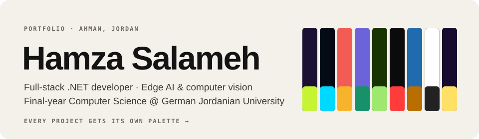
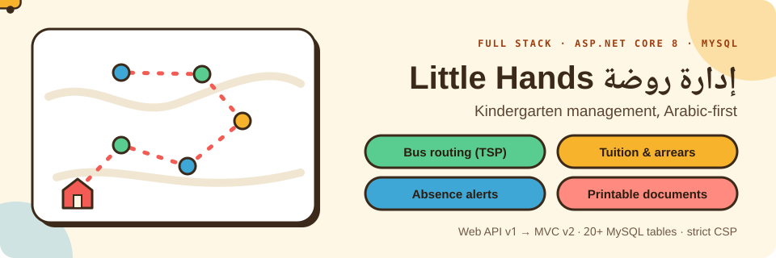
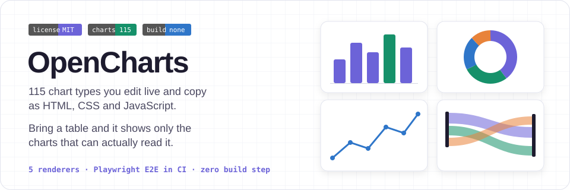
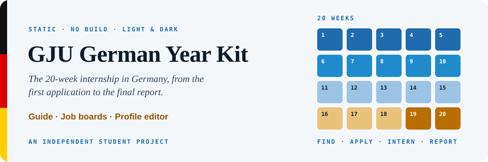

  

  <a href="https://hamza928505.github.io/Hamza928505/"><b>Portfolio</b></a> ·
  <a href="https://www.linkedin.com/in/hamza-salameh-287a53258/">LinkedIn</a> ·
  <a href="mailto:H.Salameh03@gju.edu.jo">H.Salameh03@gju.edu.jo</a> ·
  Amman, Jordan

In the summer of 2025 I built a back-office system for Umniah's call-centre team, covering the front end, back end, database and testing, on my own. It is still running today.

That was the last of three summers in Umniah's Dual Studies programme. Alongside it I'm finishing a Computer Science degree at the German Jordanian University, where my graduation project, **Visual Sentinel**, detects drones from stereo video and locates them in 3D entirely on Raspberry Pi edge hardware.

Every project below was built for a different problem, so each one gets its own colours.

## Experience

**Umniah**, Digital & IT Department · Dual Studies, July–October 2023, 2024 and 2025
- **2023, front end:** 57 responsive pages in HTML, CSS, JavaScript, Bootstrap 5 and jQuery.
- **2024, back end:** a login and user-management system with full CRUD in C#, .NET and REST APIs, tested in Postman and backed by SQL.
- **2025, full stack:** a system that lets customers send complaints and images straight to the call-centre team. I designed, built and tested it alone, and it is still in production.

**Research Assistant**, GJU DAIS Lab · 2025–2026: AL-Gen+ (below).

## Projects

**Visual Sentinel**: graduation project, 2025–2026. Dual Raspberry Pi 4 nodes with Canon cameras, IMUs and GPS are synchronised by a C orchestrator. A fine-tuned YOLOv8 detects the drone, and its position is estimated two independent ways: IMU-corrected stereo triangulation, and *DroneDepthNet*, a PyTorch residual MLP over 26 engineered features. Results are projected to GPS on a Leaflet map, and SIFT + RANSAC homography super-resolves the airframe to check for payloads.
[Live dashboard](https://hamza928505.github.io/VisualSentinel/) · [3D workstation](https://hamza928505.github.io/VisualSentinel/DigitalTwin.html)

**Little Hands**: a kindergarten management system, Arabic-first and right-to-left, 2026. It covers students, parents, staff, buses, attendance and money. It started as an ASP.NET Core Web API (JWT, Swagger, API versioning, FluentValidation, Serilog) and was folded into a standalone ASP.NET Core 8 MVC app with Dapper over MySQL. Bus stops are ordered by nearest-neighbour + 2-opt and routed with OSRM. Instalment status and absence alerts are derived on every request, the academic-year rollover can be undone, and the strict `'self'` CSP holds end to end. *Private repository.*

**OpenCharts**: 115 chart types across five renderers (Chart.js, D3, Canvas 2D, its own engine and the DOM), with no build step. *Match my data* narrows the gallery to the charts that can read your table, Excel and CSV are parsed in the browser, and every chart exports as code or as an AI prompt carrying the real schema. A headless Playwright suite in CI checks it all.
[Live](https://hamza928505.github.io/OpenCharts/) · [Source](https://github.com/Hamza928505/OpenCharts)

**ExpenseTracker**: a multi-currency personal finance PWA in vanilla JavaScript. Amounts are stored in your main currency and shown in any other with a tap. Changing the main currency re-denominates the whole ledger at the live rate, and refuses if no rate is available. Works offline, and every asset is vendored.
[Live](https://hamza928505.github.io/ExpenseTracker/) · [Source](https://github.com/Hamza928505/ExpenseTracker)

**AL-Gen+**: a research platform that generates labelled network traffic for ML intrusion-detection models. Synthetic mode draws from statistical distributions at 100,000+ records a minute. Real-attack mode runs 12 attack types against an isolated VM and DVWA. Both write the same 22-column schema, so the data merges cleanly. Python, Scikit-Learn, Pandas, PyQt5. Basis of two research papers.

**GJU German Year Kit**: a free static site for GJU students planning their German Year internship. It has a rules guide, job boards with instant local filtering, and a profile editor that keeps everything in the browser. No framework, light and dark themes, and it works on screens from 320 px up.
[Live](https://hamza928505.github.io/GJUYearKit/) · [Source](https://github.com/Hamza928505/GJUYearKit)

**CareerToAI**: a personal profile that AI assistants can actually fetch. It is pre-rendered with Eleventy and published as HTML, plain text and JSON, with a robots.txt that names and welcomes every crawler. Certificates are drafted locally by a Claude vision model and edited by hand before publishing.
[Source](https://github.com/Hamza928505/CareerToAI)

<b>Also built</b>

| Project | What it is | Stack |
|---|---|---|
| **EduCard AI** | Multi-tenant SaaS for schools to create branded educational cards, with AI generation, PDF/PowerPoint export and a template marketplace | ASP.NET Core 9 MVC, Clean Architecture, EF Core, Identity, QuestPDF, OpenXml, xUnit, Docker |
| **JobSearchEngine** | Job search over free APIs and feeds that reads a site only where its terms allow it | Python, Parallel and Exa search |
| [**RSA**](https://github.com/Hamza928505/RSA) | Step-by-step RSA key generation and string encryption in the terminal | C++, NTL |
| [**Favicon & PWA Icon Generator**](https://hamza928505.github.io/FaviconPwaGenerator/) | Every favicon and PWA icon size from one image, in the browser | HTML, CSS, JavaScript |

## Competitions

## Certifications

| Issuer | Certificate | Date |
|---|---|---|
| Red Hat | [Red Hat System Administration II (RH134)](https://www.credly.com/badges/61794989-0852-40ef-85b2-09883b3f2b67) | Jun 2026 |
| Red Hat | [Red Hat System Administration I (RH124)](https://www.credly.com/badges/6de11ab0-8211-4340-be83-daccce21bbbd) | Dec 2025 |
| freeCodeCamp × Microsoft | [Foundational C# with Microsoft](https://freecodecamp.org/certification/hamzasalameh/foundational-c-sharp-with-microsoft) | Dec 2025 |
| Brno University of Technology | BISSIT 2026 summer school: Cyber Security & Machine Learning | Aug 2026 |
| Anthropic | [Claude Code 101](https://academy.claude.com/verify/ae4b65fdd3e92a2a27852727a779ea11) · [Claude 101](https://verify.skilljar.com/c/rrv58g9d62w4) · [AI Fluency for Students](https://verify.skilljar.com/c/7bdwpk3n2pun) | Apr 2026 |
| Anthropic | Introduction to MCP · Agent Skills · Subagents · Claude Cowork | Sep 2026 |
| Ministry of Digital Economy & Entrepreneurship (Jordan) | Programming · AI · Data Analysis · Android Development Fundamentals | 2026 |
| NCSC Jordan | Cyber Warriors Training (CTF), 40 hours | Sep 2024 |

## Toolbox

- **Back end:** C#, ASP.NET Core (MVC and Web API), .NET 8, REST, Dapper, EF Core, MySQL, SQL
- **Front end:** JavaScript (ES modules, no framework), HTML, CSS, Bootstrap 5, jQuery, Chart.js, D3, Leaflet
- **ML & vision:** Python, PyTorch, YOLOv8, OpenCV, NumPy, Pandas, Scikit-Learn
- **Systems:** Linux (RHEL), Bash, C, Raspberry Pi, Git, GitHub Actions, Docker, IIS, Playwright

**Languages:** Arabic (native) · English (B1) · German (B1)
